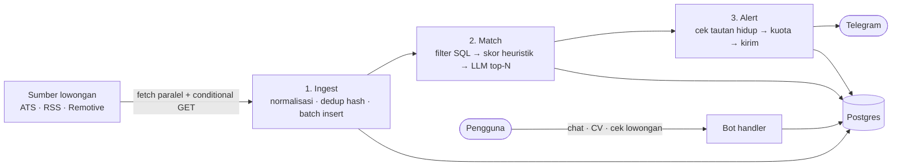

<div align="center">


# CocoKerja

**Asisten karier & kurasi lowongan berbasis AI untuk fresh graduate Indonesia.**
*Sedikit lowongan, tapi tepat sasaran.*

[](https://t.me/cocokerja_bot)
[](https://cocokerja.vercel.app)


[Coba Bot](https://t.me/cocokerja_bot) · [Website](https://cocokerja.vercel.app) · [PRD](./PRD%20-%20AI%20Career%20Launcher%20+%20Job%20Alert.md) · [Panduan Arsitektur](./AGENTS.md)

</div>

---

## Daftar Isi

- [Fitur](#fitur)
- [Prinsip Produk](#prinsip-produk)
- [Cara Kerja](#cara-kerja)
- [Perintah Bot](#perintah-bot)
- [Arsitektur](#arsitektur)
- [Menjalankan Lokal](#menjalankan-lokal)
- [Konfigurasi](#konfigurasi)
- [Deploy](#deploy)
- [Keamanan & Privasi](#keamanan--privasi)
- [Roadmap](#roadmap)

## Fitur

| | Fitur | Keterangan |
|---|---|---|
| 🎯 | **Job Alert terkurasi** | Lowongan dicocokkan dengan profil, dikirim hanya bila skornya melewati ambangmu. |
| 🧮 | **Skor transparan** | Skor heuristik berbobot yang bisa diaudit, diperhalus LLM hanya untuk kandidat teratas. |
| 🛡️ | **Anti-scam** | Setiap lowongan dicek indikasi penipuan (biaya pendaftaran, deposit, MLM). |
| ✂️ | **Tailor CV** | Menyusun ringkasan CV per lowongan. Semua klaim diverifikasi terhadap CV asli. |
| 🔎 | **Cek lowongan instan** | Tempel teks/tautan lowongan, langsung dapat analisis kecocokan. |
| 💬 | **Copilot karier** | Konsultasi karier lewat chat bebas (dibatasi kuota mingguan). |
| 🧩 | **Skill gap & tracker** | Lihat kekurangan skill per lowongan dan simpan ke tracker lamaran. |
| 🔒 | **Privasi** | CV terenkripsi AES-256-GCM; hapus seluruh data kapan saja dengan `/hapus ya`. |

## Prinsip Produk

1. **Signal over Volume**: kirim sedikit lowongan, tapi bernilai tinggi dan relevan.
2. **Anti-Hallucination**: Tailor CV dilarang keras mengarang fakta atau skill yang tidak ada di CV. Setiap sorotan wajib punya bukti kutipan (`verifyTailor` di `core/tailor.ts`).
3. **Zero Illegal Scraping**: hanya ATS publik resmi (Greenhouse, Lever, Ashby), RSS resmi, dan cek lowongan on-demand oleh pengguna.
4. **Anti-Scam First**: lowongan mencurigakan ditandai sebelum sampai ke pengguna.

## Cara Kerja

Satu siklus `tick()` menjalankan tiga tahap. Tahap dibatasi anggaran waktu agar aman di serverless; sisa pekerjaan dilanjutkan di tick berikutnya.



- **Dedup & idempotensi**: lowongan di-hash (SHA-256); update webhook Telegram ditandai agar retry tidak diproses dua kali.
- **Loker masih buka**: sebelum alert dikirim, URL dicek (`HEAD`, lalu `GET` bila perlu). 404/410 membatalkan pengiriman.
- **Kuota mingguan** (reset tiap minggu ISO):

| Paket | Alert | Skoring LLM | Chat & Tailor |
|---|---:|---:|---:|
| Free | 3 | 10 | 5 |
| Premium | 30 | 200 | 100 |

## Perintah Bot

| Perintah | Fungsi |
|---|---|
| `/start` | Mulai onboarding (persetujuan → CV → peran → lokasi → level) |
| `/profil` | Lihat skill, peran, lokasi, dan level tersimpan |
| `/status` | Paket, pemakaian alert minggu ini, dan ambang skor |
| `/ambang 70` | Atur ambang skor alert (30–95) |
| `/bantuan` | Daftar perintah |
| `/hapus ya` | Hapus profil, match, dan tracker; event dianonimkan |

Selain perintah: kirim **teks/tautan lowongan** untuk dianalisis, atau **pesan bebas** untuk konsultasi karier.

## Arsitektur

Arsitektur **hexagonal (Ports & Adapters)**: logika bisnis terpisah dari infrastruktur.

```text
src/
├── core/        Logika murni, tanpa I/O: skoring, parsing CV, dedup, enkripsi, kuota, tailor
├── ports/       Kontrak: Messenger, LlmScorer, JobSource, FetchCache
├── adapters/    Implementasi: Telegram, LLM (OpenAI-compatible), ATS/RSS, Postgres (Drizzle)
├── services/    Use case: bot, pipeline (ingest → match → alert), tick
├── app/         Entrypoint Next.js: landing, /api/telegram, /api/cron/tick, /api/health
└── config/      Validasi env (Zod)
scripts/         worker.ts (VPS), set-webhook.ts, seed.ts, import-jobs.ts, migrate-perf-indexes.ts
```

Aturan ketergantungan: `core` ← `services` ← (`app` | `scripts`). Entrypoint hanya menyambungkan, sehingga **Vercel dan VPS memakai kode bisnis yang sama**.

| | Vercel (uji coba) | VPS (produksi) |
|---|---|---|
| Penerimaan pesan | Webhook `/api/telegram` | Long polling (`scripts/worker.ts`) |
| Penjadwalan | `/api/cron/tick` (cron-job.org tiap 10–15 mnt; Vercel Cron Hobby hanya harian) | Loop `tick()` di worker |
| Database | Neon/Supabase Postgres (URL pooled) | Postgres di docker-compose |
| Proses | Serverless, dibatasi anggaran waktu | Docker: web + worker + db |

## Menjalankan Lokal

**Prasyarat:** Node.js ≥ 20 dan sebuah database Postgres.

```bash
npm install
cp .env.example .env     # isi nilai wajib (lihat tabel Konfigurasi)
npm run db:push          # buat tabel (HANYA untuk database lokal/baru)
npm run seed             # lowongan contoh (opsional)
npm run worker           # bot via polling + tick; tidak perlu webhook
npm run dev              # landing page di http://localhost:3000
```

> [!CAUTION]
> Jangan menjalankan `db:push` (`drizzle-kit push`) ke database **produksi**. Perintah ini bisa meminta *truncate* tabel akibat perbedaan nama constraint. Untuk perubahan skema produksi, pakai skrip SQL manual (`ALTER TABLE ... ADD COLUMN IF NOT EXISTS`), contohnya [`scripts/migrate-perf-indexes.ts`](./scripts/migrate-perf-indexes.ts).

**Perintah pengembangan**

| Perintah | Fungsi |
|---|---|
| `npm test` | Jalankan semua test (wajib lulus sebelum commit) |
| `npm run typecheck` | Cek tipe TypeScript |
| `npm run build` | Build produksi |
| `npx tsx --env-file=.env scripts/import-jobs.ts <file.json\|file.csv>` | Impor lowongan manual |

## Konfigurasi

Salin [`.env.example`](./.env.example) menjadi `.env`. Variabel utama:

| Variabel | Wajib | Keterangan |
|---|:---:|---|
| `DATABASE_URL` | ✅ | Postgres (gunakan URL *pooled* di serverless) |
| `TELEGRAM_BOT_TOKEN` | ✅ | Token dari @BotFather |
| `TELEGRAM_WEBHOOK_SECRET` | ✅ | Acak ≥ 16 karakter: `openssl rand -hex 24` |
| `CRON_SECRET` | ✅ | Bearer secret untuk `/api/cron/tick` (≥ 16 karakter) |
| `ENCRYPTION_KEY` | ✅ | `openssl rand -base64 32` |
| `JOB_SOURCES` | – | `greenhouse:slug,lever:slug,ashby:slug,remotive` |
| `JOB_FEEDS` | – | URL RSS dipisah koma (hanya sumber yang mengizinkan) |
| `LLM_BASE_URL` / `LLM_API_KEY` / `LLM_MODEL` | – | LLM kompatibel OpenAI. Kosongkan untuk skor heuristik saja |
| `GEMINI_API_KEY` / `GEMINI_MODEL` | – | LLM cadangan |
| `TICK_BUDGET_MS` | – | Batas waktu satu tick (default 45000; Vercel Hobby ≤ 45000) |
| `TICK_INTERVAL_MS`, `DB_POOL_MAX` | – | Khusus worker VPS |

> [!WARNING]
> **Jangan mengganti `ENCRYPTION_KEY`** setelah ada data. CV yang sudah tersimpan tidak akan bisa didekripsi. Jangan pernah meng-commit file `.env`.

## Deploy

### Vercel (uji coba)

1. Buat database Postgres (Neon/Supabase) dan siapkan skemanya.
2. Impor repo ke Vercel, isi semua env dari `.env.example`.
3. Setelah deploy, pasang webhook:
   ```bash
   npx tsx --env-file=.env scripts/set-webhook.ts https://<app>.vercel.app
   ```
4. Buat pemicu tiap 10–15 menit (mis. cron-job.org) ke `GET https://<app>.vercel.app/api/cron/tick` dengan header `Authorization: Bearer <CRON_SECRET>`.

### Migrasi ke VPS (≈ 1 hari)

<details>
<summary>Langkah-langkah</summary>

1. `pg_dump` dari database lama, restore ke VPS (atau tetap pakai DB lama dulu).
2. Salin `.env`, set `POSTGRES_PASSWORD`, lalu `docker compose up -d --build`.
3. Pasang Nginx/Caddy + HTTPS di depan port 3000 (untuk landing).
4. Worker otomatis memakai polling (menghapus webhook). Pantau 24–48 jam, lalu matikan Vercel.

</details>

## Keamanan & Privasi

- CV disimpan terenkripsi **AES-256-GCM** (`ENCRYPTION_KEY`) dan tidak pernah masuk log.
- Webhook Telegram diverifikasi lewat header secret; cron lewat bearer secret (perbandingan *constant-time*).
- Idempotensi update Telegram (`tg_updates`), dedup lowongan berdasar hash, unik per (user, lowongan).
- `/hapus ya` menghapus profil, match, dan tracker; event dianonimkan.
- LLM hanya menerima skill, ringkasan pendidikan, dan preferensi, **tanpa CV mentah atau identitas**.

## Roadmap

- [x] Onboarding, parsing CV, dan job alert terjadwal
- [x] Skor heuristik + penyempurnaan LLM, deteksi scam
- [x] Cek lowongan on-demand, skill gap, tracker sederhana
- [x] Tailor CV dengan verifikasi anti-halusinasi
- [x] Pencarian cepat (trigram) & conditional GET untuk RSS
- [ ] Simulasi interview
- [ ] Tracker status lamaran penuh
- [ ] Pembayaran & paket Premium
- [ ] Kanal WhatsApp

Tabel `jobs_queue` dan `subscriptions` sudah disiapkan di skema untuk fase berikutnya.
